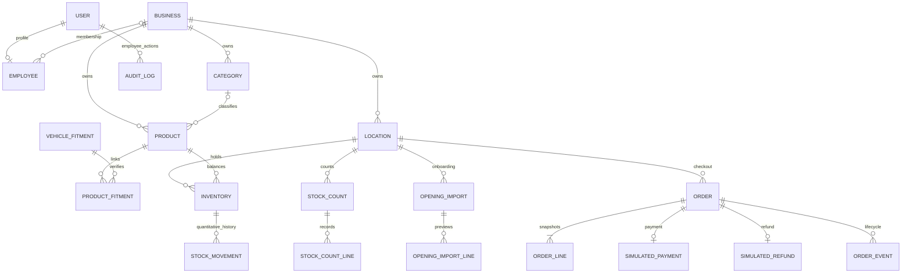

# Orvexa B0 — Audit and foundation

**Product:** Orvexa. **Company:** Osyntra. **Scope:** existing Spring Boot server only.

> Historical B0 snapshot: the user subsequently authorized B1. See [ORVEXA_B1_IMPLEMENTATION.md](ORVEXA_B1_IMPLEMENTATION.md) for current membership, branch, session/MFA and email behavior; B2 remains pending.

This assessment executes Phase B0 of [Orvexa_Backend_Implementation_Prompts.md](Orvexa_Backend_Implementation_Prompts.md). The plan explicitly requires one phase per review cycle. B1–B9 are assessed and staged here; they have not been implemented by this B0 change.

## Database decision and preservation

The user confirmed that SQLite remains the default for the MVP and tests, and that the PostgreSQL settings belong to a local Docker container. PostgreSQL is therefore a readiness assessment, not a B0 switch or migration requirement. The existing .env, credentials, local SQLite database, demo accounts, API paths, package names and Maven artifact ID are preserved.

Docker Compose inspection found that Docker Desktop's Linux-engine pipe was unavailable. No PostgreSQL connectivity or authenticated database check succeeded, and no PostgreSQL startup/migration is claimed. Historical PostgreSQL V5–V8 scripts and connection configuration remain untouched. The guard that prevents running the SQLite-only services against that incomplete schema remains in place.

There are **no B0 data migrations**. SQLite V1–V6 remain unchanged. Existing tests verify fresh SQLite initialization, populated V1 upgrade, repeat migration, tenant boundaries and transaction behavior.

## Current implementation inventory

| Area | Existing implementation | Orvexa requirement gap |
| --- | --- | --- |
| Runtime/build | Java 24, Spring Boot 4.1.1, Maven, modular service/repository/controller layers, SpringDoc | Existing packages are layered rather than feature modules; evolve boundaries incrementally |
| Identity | Global unique email/password, BCrypt, Basic authentication, employee active/deactivated state | One employee membership per account; no invitations, verification/reset, sessions/revocation, MFA, rate limiting or Administrator role |
| Platform/tenancy | Businesses, locations, operator provisioning, tenant-scoped services and composite FKs | Operator flag is on users; platform roles are not yet a separate administration model; no branch-access grants or business switcher |
| Catalog | Generic products/categories, tenant SKUs/barcodes, units/cost/threshold fields, product archive, verified relational vehicle fitment | No variant parents, explicit unit conversions, generated internal labels, tax classifications or catalog XLSX imports |
| Inventory | Per-location on-hand/reserved balance, reason-coded ledger, receipts/damage/corrections, approved resumable counts, opening CSV preview/commit | No location weighted-average valuation, batches/expiry, suppliers, purchasing, partial receiving or transfer lifecycle |
| Commerce | Server-priced cart, POS/ONLINE reservation, simulated payment, expiry, cancellation, full returns/refunds, historical price/cost snapshots and text receipt | No tax/discount snapshots, partial returns/refunds, provider interface, manual terminal confirmation, UNKNOWN/reconciliation state, PDF/email receipts |
| Reporting | Stock/value estimates, low-stock alerts, date/channel/product sales, gross/refund/net totals, stock CSV | No weighted-average COGS, tax/PO/transfer/batch analytics, report builder, forecasts or scheduled XLSX exports |
| Audit/retries | Employee audit, quantitative movement ledger, order events, command receipts/fingerprints, private public-order capabilities | No transactional outbox, durable external-delivery retries, controlled support authorization, retention/legal-hold/closure workflows |
| Operations | SQLite WAL/busy timeout/IMMEDIATE transactions, backup/restore script and restore evidence, local demo | No production deployment, PostgreSQL parity/PITR, encrypted offsite retention or monitored delivery/payment/provider integrations |

The earlier SQLite MVP phases 1–5 are useful working behavior. They do **not** mean Orvexa B1–B9 are complete. In particular, product cost is not weighted-average location cost; CSV opening-stock import is not catalog import; a simulated successful=false result is not an uncertain bank payment; Basic authentication is not the required MFA/session identity system.

## Existing entity relationship map

This diagram represents current tables, not future features. EMPLOYEE is currently the single membership/profile. Platform operators are users with is_operator and a null employee business_id.



Other persistence: movement_reasons, command_receipts, platform_audit and demo_seeds. The exact SQL and constraints remain in db/migration/sqlite. No new parallel catalog, stock or checkout service is proposed.

## B0 implementation

1. Open GET /actuator/health and its liveness/readiness probes through Spring Security. Only coarse status is public; details/components stay hidden. Readiness includes the database indicator. Other Actuator endpoints remain unexposed/denied.
2. Add X-Request-ID to every response, accepting only canonical UUID input and generating a new UUID otherwise. Put it in MDC for request logging, restore thread context afterward, and expose it to the separately hosted frontend through configured CORS.
3. Share an application/problem+json contract between security filters and controller advice. Add stable code/requestId fields; retain HTTP semantics for validation, missing resources, conflicts and framework errors. SQL/unexpected diagnostics are not returned to clients. Database availability errors return 503 with Retry-After.
4. Use Orvexa as the product name and Osyntra as the company in API metadata, application logging identity, Maven display metadata and receipt heading. Preserve existing package/artifact IDs, URLs, filenames, environment names and stored business names for compatibility.
5. Interpret typed JDBC timestamp text explicitly as UTC so a Jamaican host timezone does not shift serialized Instants. Existing raw map timestamp strings continue to denote UTC; consistent offset-bearing versioned response DTOs remain an API-contract improvement for later phases.
6. Replace the README's literal local demo password with instructions to use existing ignored environment configuration or a secure prompt. Existing account passwords are not reset and runtime credentials are not hardcoded.

Affected production files: SecurityConfig, CorsConfig, OpenApiConfig, RequestCorrelationFilter, ApiProblems, ApiExceptionHandler, DatabaseDialect, typed JDBC mappers, application.properties, pom.xml and the receipt heading. Tests: FoundationTests, UtcTimestampTests and the existing regression suite. Documentation: this assessment, README, MVP_PROGRESS and ARCHITECTURE_DECISIONS.

## API contract additions

Health:

```http
GET /actuator/health
GET /actuator/health/liveness
GET /actuator/health/readiness
```

Healthy response: HTTP 200 and {"status":"UP"}, without database details. A readiness failure can return 503. Diagnostic management endpoints are not made public.

Errors preserve their status and now include a stable machine code and trace identifier:

```json
{
  "type": "urn:orvexa:error:resource-not-found",
  "title": "Not Found",
  "status": 404,
  "detail": "Product not found",
  "instance": "/api/products/00000000-0000-0000-0000-000000000001",
  "code": "RESOURCE_NOT_FOUND",
  "requestId": "269721a4-b0b7-4d2d-93d4-443173c177bd"
}
```

Codes: VALIDATION_FAILED, UNAUTHENTICATED, FORBIDDEN, RESOURCE_NOT_FOUND, CONFLICT, INTERNAL_ERROR, SERVICE_UNAVAILABLE; other framework status codes use HTTP_<status>. The response X-Request-ID matches the body's requestId. Request IDs trace HTTP calls; they are not business idempotency keys, credentials or order capabilities. A retryable write keeps its original command requestId even when its HTTP trace ID changes.

## Staged implementation after B0

| Phase | Minimal extension of existing code | Required acceptance work |
| --- | --- | --- |
| B1 | Migrate Employee's one-business association into memberships with unique user/business, exactly one fixed role and branch grants. Backfill existing users safely; separate platform authorities. Add validated active membership selection, invitation/token/outbox lifecycle, sessions, recovery, rate limiting and owner/platform MFA. | Two-business account, branch denial, IDOR, role boundaries, token replay/expiry/revocation and MFA/session tests |
| B2 | Extend settings and onboarding state. Introduce effective-dated tax profiles/classifications, verified illustration flags, rounding and immutable sale-time tax snapshots. | Nonregistered, taxable, zero-rated, exempt and historical-rate tests; independent TAJ/accountant verification before real use |
| B3 | Extend current products/fitments with variant relationships, explicit base-unit conversions, internal barcode/label namespace and bounded catalog CSV/XLSX jobs. | Uniqueness, conversions, file validation, mapping, rollback/retry and formula safety |
| B4 | Retain StockLedger as the quantity boundary; add location acquisition value/weighted-average policy, supplier/PO receiving, batches and transfer states. | Cost arithmetic, concurrent receipt/adjustment, partial PO, expiry enforcement and transfer reconciliation |
| B5 | Extend CommerceService's snapshots and transitions behind a payment-provider interface. Add manual confirmation and uncertain outcomes with reconciliation/stock holds, tax/discount snapshots and approved partial reversals. | Last-unit races, duplicate retry/webhook, UNKNOWN outcomes, tax snapshot and refund arithmetic |
| B6 | Add optional tenant customer linkage, consent, loyalty ledger/refund reversal, constrained promotions and notification outbox/delivery logs. | Customer isolation, consent/opt-out, points double-spend and promotion limits |
| B7 | Extend reports from historical sale/valuation ledgers; add secure export jobs and constrained report scheduling/builder, then labeled forecasts and closure/retention state. | Source reconciliation, export safety, permissions and retention/legal holds |
| B8 | Add feature-flagged provider adapters around authoritative inventory and idempotent inbound commands. | Provider sandbox credentials, webhook signatures, order/conflict mapping and reconciliation |
| B9 | Add entitlements/restricted states and separate MFA-protected platform APIs, then operational instrumentation and encrypted backup/PITR procedures. | Restricted exports/reconciliation access, support audit, restore drills and alert checks |

Keep current APIs operational while introducing a documented versioned contract for membership-aware behavior. Add feature boundaries through small services/repositories as capabilities arrive; do not bulk-rename packages or implement speculative provider infrastructure. External email/webhook effects need an outbox before integrations send them; do not send from inside inventory/payment transactions.

## Manual prerequisites and limitations

- PostgreSQL is deliberately not required for this B0, per user direction. Its Docker engine was unavailable, its modern schema is incomplete, and no PostgreSQL behavior is verified.
- Invitation/verification/reset email delivery requires a separately configured provider and outbox. No SMTP configuration was invented or external email sent.
- Real terminal adapters require actual bank/vendor access and merchant approval. Current receipts/payments remain simulated.
- B2 tax settings require appropriate verification; this assessment makes no tax-law or GCT eligibility claims.
- Production MFA, abuse protection, session revocation, cloud hosting, encrypted offsite recovery, entitlements and closure policies remain future work.

## Verification and review boundary

The first B0 test run passed all 40 tests (the previous 32 plus eight focused foundation tests). Adding the UTC parsing regression brought the final suite to **41 tests, zero failures/errors/skips**. The full suite passed during `mvn -q package`. Windows then blocked JAR repackaging because the existing demo process held it open; after confirming the listener/process identity, the backend was stopped, `mvn -q "-DskipTests" package` completed, and the tested artifact was restarted in sqlite,demo mode.

Live HTTP checks on port 8080 verified health/liveness/readiness UP without components, echoed X-Request-ID, Orvexa OpenAPI identity, and the 401 ProblemDetail code/requestId contract. All eight existing automotive/grocery demo logins were verified without changing passwords. `git diff --check` passes. The local .env and all SQL migration files are unchanged by B0.

The recommended next phase is **B1 — Identity, memberships, tenancy and invitations**. Stop after B0 for review, as required by the supplied implementation plan. Database choice remains SQLite unless the user explicitly changes that direction.
